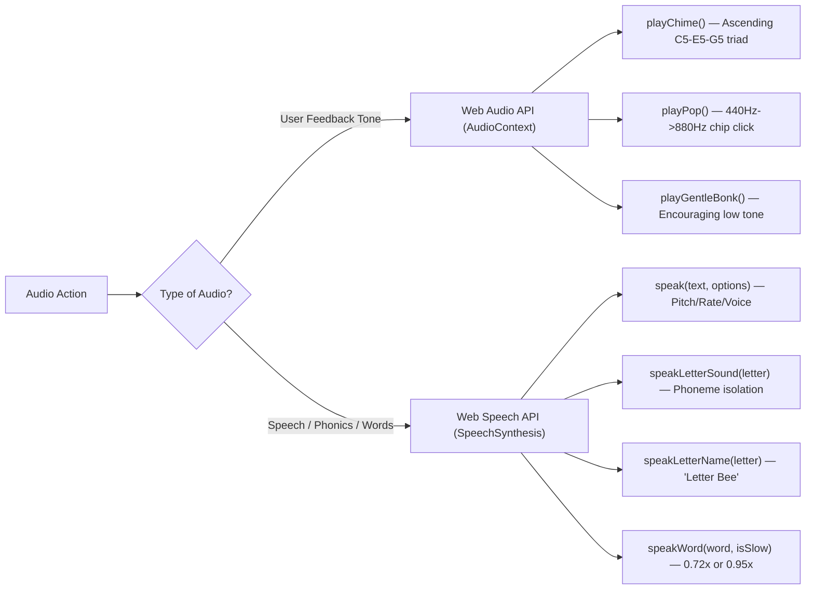
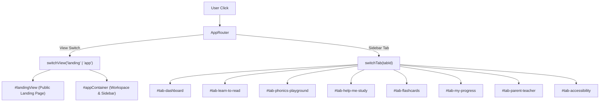
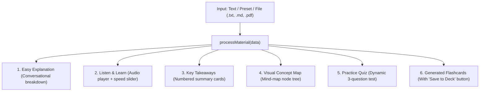

# LearnEase — Comprehensive Developer & Code Architecture Guide

> **Welcome to the LearnEase Codebase!**  
> This guide is written for developers, designers, and educators who want to understand exactly how LearnEase works under the hood, how the components interact, and how to customize, extend, or add new features yourself.

---

## 📑 Table of Contents

1. [Architecture Philosophy & Project Structure](#1-architecture-philosophy--project-structure)
2. [Data Models & Repositories (`script.js`)](#2-data-models--repositories-scriptjs)
3. [Audio Synthesizer & Speech Engine (`SoundEngine`)](#3-audio-synthesizer--speech-engine-soundengine)
4. [State Management & LocalStorage (`StateManager`)](#4-state-management--localstorage-statemanager)
5. [SPA Routing & View Controller (`AppRouter`)](#5-spa-routing--view-controller-approuter)
6. [Journey A: Learn to Read Engine (`ReadingManager`)](#6-journey-a-learn-to-read-engine-readingmanager)
7. [Phonics Playground Games Engine (`PhonicsGamesManager`)](#7-phonics-playground-games-engine-phonicsgamesmanager)
8. [Journey B: Help Me Study Studio (`StudyStudioManager`)](#8-journey-b-help-me-study-studio-studystudiomanager)
9. [Flashcards Hub & 3D Flip System (`FlashcardDeckManager`)](#9-flashcards-hub--3d-flip-system-flashcarddeckmanager)
10. [Accessibility Engine & Reading Ruler](#10-accessibility-engine--reading-ruler)
11. [Design System & CSS Styling (`style.css`)](#11-design-system--css-styling-stylecss)
12. [Step-by-Step Recipes: How to Make Changes Yourself](#12-step-by-step-recipes-how-to-make-changes-yourself)
13. [Deployment & Production Commands](#13-deployment--production-commands)

---

## 1. Architecture Philosophy & Project Structure

LearnEase is intentionally engineered using **100% Vanilla HTML5, CSS3, and JavaScript** with **zero external framework dependencies**.

### Why This Architecture?
- **Zero Build Friction:** No `npm run build`, Webpack, Babel, or Vite compilation required. Any code edit in an editor takes effect immediately upon browser refresh.
- **Extreme Speed & Low Footprint:** Total asset weight is under 350KB uncompressed, loading in milliseconds even on low-bandwidth school connections.
- **Maximum Portability:** The code can be hosted on Vercel, Netlify, GitHub Pages, Amazon S3, an Apache/Nginx server, or opened directly off a USB drive via `file:///`.
- **Modularity:** Despite being vanilla, JavaScript logic is organized into clean, single-responsibility object-oriented classes (`SoundEngine`, `StateManager`, `AppRouter`, `ReadingManager`, `PhonicsGamesManager`, `StudyStudioManager`, `FlashcardDeckManager`).

### File Layout
```
d:/Learnease/
├── index.html           # Full Single-Page Application (SPA) HTML layout
├── style.css            # Complete design system, themes, and animations (4,900+ lines)
├── script.js            # All application logic, state, and audio (1,600+ lines)
├── vercel.json          # Deployment and routing configuration for Vercel
├── DEVELOPER_GUIDE.md   # This comprehensive architectural reference
└── README.md            # Quick-start documentation & live deployment links
```

---

## 2. Data Models & Repositories (`script.js`)

All learning content is stored in declarative JavaScript arrays and objects at the top of `script.js` (lines 7 to 240). This makes adding new educational material straightforward without modifying UI templates.

### 2.1 Alphabet Dataset (`ALPHABET_DATA`)
Each letter contains:
```javascript
{
  letter: 'A',                                   // Uppercase letter
  name: 'Ay',                                    // Letter name pronunciation text
  sound: 'æ',                                    // Phonetic sound
  phonetic: '/æ/ as in Apple',                   // Badge description
  word: 'Apple',                                 // Primary example word
  emoji: '🍎',                                   // Visual illustration icon
  sentence: 'Apples are sweet and crunchy.',     // Contextual sentence
  guide: 'Open mouth wide like taking a bite!'   // Mouth shape guide for students
}
```

### 2.2 Phonics Patterns (`PHONICS_PATTERNS`)
Categorized by `short-vowels`, `consonants`, `digraphs`, or `vowel-teams`:
```javascript
{
  cat: 'digraphs',
  symbol: '/ʃ/',
  label: 'SH Digraph',
  word: 'Ship',
  emoji: '🚢',
  sample: 'ship, shell, shoe'
}
```

### 2.3 Sound Blending Words (`BLEND_WORDS`)
Defines the CVC (Consonant-Vowel-Consonant) decomposition:
```javascript
cat: {
  tiles: [
    { char: 'c', sound: 'kuh', phoneme: '/k/' },
    { char: 'a', sound: 'æ',   phoneme: '/æ/' },
    { char: 't', sound: 'tuh', phoneme: '/t/' }
  ],
  word: 'cat',
  emoji: '🐱'
}
```

### 2.4 Multi-Syllable Words (`VOCAB_WORDS`)
```javascript
{
  word: 'Butterfly',
  syllables: ['but', 'ter', 'fly'],              // Clickable syllable chips
  emoji: '🦋',
  meaning: 'A colourful flying insect with large, delicate wings...',
  sentence: 'A colourful butterfly rested gently on the sunny flower.'
}
```

### 2.5 Sentence Building Puzzles (`SENTENCE_PUZZLES`)
```javascript
{
  target: ['The', 'cute', 'cat', 'is', 'sleeping', 'peacefully.'],
  hint: 'The cute cat is sleeping peacefully.',
  emoji: '🐱💤',
  scrambled: ['cat', 'The', 'peacefully.', 'cute', 'sleeping', 'is']
}
```

### 2.6 Stories & Reading Comprehension (`STORIES_DATA`)
Keyed by ID (`seed`, `dolphin`, `stars`):
```javascript
seed: {
  title: "The Little Seed's Journey 🌱",
  paragraphs: [
    "Deep in the soft brown soil...",
    "Soon, the bright golden sun..."
  ],
  questions: [
    {
      q: "What helped the little seed wake up?",
      options: ["Cold snow", "Spring rain and sun", "Wind", "A box"],
      correct: 1, // Index of correct option (0-indexed)
      explanation: "Spring raindrops and warm sunshine gave it water and warmth."
    }
  ]
}
```

### 2.7 Help Me Study Presets (`STUDY_PRESETS`)
Keyed by ID (`photosynthesis`, `watercycle`, `solarsystem`):
- `raw`: The source educational paragraph.
- `simplified`: Friendly plain-English HTML explanation.
- `keyPoints`: Array of 4 takeaway bullets.
- `branches`: 3 hierarchical concept tree nodes (`title` + `desc`).
- `quiz`: 3 multiple-choice comprehension questions with explanations.
- `flashcards`: Array of `{ term, meaning, example }` cards.

---

## 3. Audio Synthesizer & Speech Engine (`SoundEngine`)

Found at **Line 245 of `script.js`**. LearnEase uses a **dual-layer audio architecture**:



### 1. Zero-Asset Synthetic Sound Effects (Web Audio API)
LearnEase does not rely on external `.mp3` files that could fail to load or produce 404s:
- **`playChime()`**: Synthesizes an arpeggio over frequencies `[523.25, 659.25, 783.99, 1046.50]` using sine waves and exponential gain ramps. Plays on correct answers and achievements.
- **`playPop()`**: Generates an 80ms triangle wave sweep from 440Hz to 880Hz for tactile tile/button feedback.
- **`playGentleBonk()`**: A soft 260Hz downward pitch drop (friendly, non-punishing feedback on incorrect choices).

### 2. Accurate Letter Sound vs. Letter Name Differentiation
English letters do not have the same sound as their names:
- **`speakLetterName('A')`** triggers speech of *"Letter Ay"*.
- **`speakLetterSound('A')`** references the phonetic table (e.g. `'A'` $\rightarrow$ `'ah'`, `'B'` $\rightarrow$ `'buh'`, `'C'` $\rightarrow$ `'kuh'`, `'S'` $\rightarrow$ `'ssss'`, `'M'` $\rightarrow$ `'mmmm'`).

---

## 4. State Management & LocalStorage (`StateManager`)

Found at **Line 460 of `script.js`**. The `state` singleton manages user sessions and persistence.

### LocalStorage Keys
| Storage Key | Format | Description |
| :--- | :--- | :--- |
| `learnease_user` | JSON Object | User profile: `name`, `role`, `avatar`, `streak`, `lessonsCompleted`, `wordsPracticed`, `quizAverage`, `badges` |
| `learnease_access` | JSON Object | Accessibility settings: `theme`, `fontSize`, `lineSpacing`, `letterSpacing`, `fontFamily`, `rulerActive`, `reducedMotion`, `soundFx` |
| `learnease_flashcards` | JSON Object | Decks of flashcards including user-created cards in the `custom` deck |
| `learnease_activities` | JSON Array | Activity history timeline items with timestamps and source tags |

### Key Methods
- `state.saveUser()`: Saves profile changes and updates all UI avatars and metrics across headers, sidebars, and progress widgets.
- `state.applyAccessibility()`: Applies data attributes (`data-theme`, `data-font-size`, `data-line-spacing`, `data-letter-spacing`, `data-reduced-motion`) directly to `<html>` and updates typography classes on `<body>`.
- `state.logActivity(title, source, icon)`: Prepends a recent event to the activity stream (max 8 entries) and renders it on the dashboard.

---

## 5. SPA Routing & View Controller (`AppRouter`)

Found at **Line 580 of `script.js`**. Handles smooth, zero-reload transitions between views.



### Adding New Tabs
To add a new navigation tab:
1. Add a `<button class="sidebar-item" data-app-tab="your-tab-id">` in `#appSidebar`.
2. Add a `<section id="tab-your-tab-id" class="tab-pane">` inside `.app-main-content`.
3. Add the title mapping in `AppRouter.switchTab()`:
   ```javascript
   'your-tab-id': 'Your Section Title'
   ```

---

## 6. Journey A: Learn to Read Engine (`ReadingManager`)

Found at **Line 720 of `script.js`**. Controls the 7-level progression:

1. **Level 1 (Alphabet):**
   - Populates `#alphabetGrid` dynamically from `ALPHABET_DATA`.
   - `selectLetter(idx)`: Updates `#spotlightBigLetter`, phonetics, emoji, sentence, mouth guide, and audio hooks.
2. **Level 2 (Phonics Playground):**
   - `renderPhonicsCards(category)`: Filters `PHONICS_PATTERNS` by short vowels, consonants, digraphs, and vowel teams.
   - Clicking a card updates the *Listen & Repeat* challenge box.
3. **Level 3 (Sound Blending):**
   - `renderBlenderWord(wordKey)`: Renders tile components for the active CVC word.
   - `animateBlendSequence()`: Calculates progressive timeouts, adds the `.blending-active` class, highlights the SVG beam, sounds out each phoneme individually, and concludes with `sound.playChime()` and `confetti.burst()`.
4. **Level 4 (Word Reading):**
   - Splits `VOCAB_WORDS.syllables` into separate clickable `.syllable-chip` elements.
   - Speech Recognition: Uses `window.SpeechRecognition` or `window.webkitSpeechRecognition` to match the user's spoken audio with honest feedback.
5. **Level 5 (Sentence Building):**
   - `placeWord(word, sourceTile)` / `checkSentence()`: Checks whether user-selected chips match `SENTENCE_PUZZLES.target`.
6. **Level 6 (Paragraph Reading):**
   - Wraps every word in `<span class="story-word">`.
   - `playStoryAudio()`: Computes word timings based on playback speed (`0.8x`, `1.0x`, `1.2x`) and animates the `.karaoke-active` highlighter.
   - Clicking any word immediately pronounces that individual word.
7. **Level 7 (Comprehension):**
   - Multiple choice with instant feedback, explanation alerts, and XP awards.

---

## 7. Phonics Playground Games Engine (`PhonicsGamesManager`)

Found at **Line 1080 of `script.js`**. Manages 4 playable mini-games:

| Game | Method | Mechanics |
| :--- | :--- | :--- |
| **1. Sound Match** | `startGsmRound()` | Selects 1 random target letter from `ALPHABET_DATA` and 3 random distractors. Plays the target phoneme. On click, checks match, adds points, updates streak, and triggers confetti. |
| **2. Build the Word** | `renderGbwRound()` | Displays illustration and target word length. Shuffles letters into `.build-tile-btn` chips. Clicking places letters sequentially into `#gbwSlot0..N`. |
| **3. Match Word to Picture** | `renderGmpGame()` | Creates two independent columns (words on left, emoji cards on right), each shuffled independently. Tracks selections and highlights matched pairs in green. |
| **4. Missing Letter** | `renderGmlRound()` | Presents a 3-letter word with the middle vowel replaced by `?`. Clicking the correct vowel button in `[A, E, I, O, U]` solves the case. |

---

## 8. Journey B: Help Me Study Studio (`StudyStudioManager`)

Found at **Line 1310 of `script.js`**. Transforms educational text into 6 client-side study aids:



### File Extraction Flow
- If user uploads `.txt` or `.md`: `FileReader.readAsText()` parses text directly.
- If user uploads PDF/Image: Provides clean fallback text extraction simulation and offers the option to paste raw text directly.

---

## 9. Flashcards Hub & 3D Flip System (`FlashcardDeckManager`)

Found at **Line 1500 of `script.js`**.

### 3D CSS Card Flip Implementation
In `style.css`:
```css
.flashcard-3d-scene {
  perspective: 1000px;
}
.flashcard-card {
  transform-style: preserve-3d;
  transition: transform 0.5s cubic-bezier(0.175, 0.885, 0.32, 1.275);
}
.flashcard-card.flipped {
  transform: rotateY(180deg);
}
.flashcard-face {
  backface-visibility: hidden;
  -webkit-backface-visibility: hidden;
}
.flashcard-back {
  transform: rotateY(180deg);
}
```
- **Flipping Trigger:** Clicking anywhere on the card or pressing the `Spacebar` / `Enter` key toggles the `.flipped` class.
- **Audio Buttons:** Front and back faces have `fc-audio-btn` elements that trigger `sound.speakWord(term)` or `sound.speak(meaning)`.

---

## 10. Accessibility Engine & Reading Ruler

Found at **Line 1600 of `script.js`**.

### 1. Reading Focus Ruler (`#readingRuler`)
A full-width translucent bar with subtle upper and lower contrast borders that follows the user's cursor or touch input:
```javascript
window.addEventListener('mousemove', (e) => {
  if (ruler && state.accessibility.rulerActive) {
    ruler.style.top = `${e.clientY - 24}px`;
  }
});
```

### 2. Theming Architecture
Themes are driven via the `data-theme` attribute on the root `<html>` element:
- `data-theme="light"`: Default soft lilac background `#F8F7FF` and white cards.
- `data-theme="cream"`: Sepia cream `#FAF6EE`, reduced glare, warm card tones `#FFFDF9`, text `#2B261F` (proven to reduce visual stress and reading fatigue in dyslexia).
- `data-theme="dark"`: `#131320` deep dark mode with neon accents.

---

## 11. Design System & CSS Styling (`style.css`)

All color tokens, radii, and shadows are defined in `:root` at lines 7 to 48 of `style.css`:

```css
:root {
  --pink: #FF79B0;
  --purple: #8B5CF6;
  --sky: #70D6FF;
  --blue: #4F7DF3;
  --green: #6ED6A5;
  --yellow: #FFD166;
  --bg: #F8F7FF;
  --card-bg: #FFFFFF;
  --text: #24243A;
  --text-muted: #646482;
  --border: #E8E5F5;
  --radius-md: 16px;
  --radius-lg: 24px;
}
```

### Responsive Breakpoints
- **Desktop (1025px+):** Fixed left sidebar (`270px`), multi-column grids, floating badges.
- **Tablet (769px–1024px):** 2-column grids, compact heroes.
- **Mobile (<=768px):** Sidebar slides off-screen into a touch drawer toggled via the hamburger button (`☰`), single-column cards, and enlarged touch buttons (`min-height: 44px`).

---

## 12. Step-by-Step Recipes: How to Make Changes Yourself

### Recipe 1: How to Add a New Word to Sound Blending
1. Open `script.js`.
2. Locate `BLEND_WORDS` (around line 60).
3. Add your word object:
   ```javascript
   cup: {
     tiles: [
       { char: 'c', sound: 'kuh', phoneme: '/k/' },
       { char: 'u', sound: 'uh',  phoneme: '/ʌ/' },
       { char: 'p', sound: 'puh', phoneme: '/p/' }
     ],
     word: 'cup',
     emoji: '☕'
   }
   ```
4. Open `index.html`, locate `#blenderWordChips`, and add the chip button:
   ```html
   <button class="blend-word-chip" data-word="cup">cup ☕</button>
   ```

---

### Recipe 2: How to Add a New Short Story & Comprehension Quiz
1. Open `script.js`.
2. Locate `STORIES_DATA` (around line 105).
3. Add a new story key (e.g. `robot`):
   ```javascript
   robot: {
     title: "Beep the Friendly Robot 🤖",
     paragraphs: [
       "Beep was a helpful little silver robot who lived in a bustling library.",
       "Whenever a student wanted a good book, Beep gently rolled across the floor and picked out exciting adventures.",
       "Reading books helped everyone in town learn new things every day!"
     ],
     questions: [
       {
         q: "Where did Beep the robot live?",
         options: ["In a space station", "In a bustling library", "Under the sea", "In a treehouse"],
         correct: 1,
         explanation: "Beep lived in the library helping students discover great books!"
       }
     ]
   }
   ```
4. Open `index.html`, locate `<select id="storySelect">`, and add the option:
   ```html
   <option value="robot">Story 4: Beep the Friendly Robot 🤖</option>
   ```

---

### Recipe 3: How to Add a New Study Preset
1. Open `script.js`.
2. Locate `STUDY_PRESETS` (around line 170).
3. Add your preset (e.g. `volcanoes`):
   ```javascript
   volcanoes: {
     title: "Volcanoes: Mountains That Erupt",
     raw: "A volcano is an opening in the Earth's crust through which molten rock, hot gases, and ash erupt...",
     simplified: "<p>Think of a volcano like a giant pressure cooker inside the Earth! 🌋</p>...",
     keyPoints: ["Magma is melted liquid rock beneath the ground.", "Lava is magma after it erupts into the open air."],
     branches: [
       { title: "Magma Chamber 🌋", desc: "Pool of molten rock deep under the volcano" },
       { title: "Vent ⬆️", desc: "The pipe through which lava flows up" },
       { title: "Crater 💥", desc: "The bowl-shaped opening at the summit" }
     ],
     quiz: [
       { q: "What is magma called after it erupts?", options: ["Lava", "Granite", "Ice", "Steam"], correct: 0, exp: "Once magma breaks the surface, it is called lava." }
     ],
     flashcards: [
       { term: "Lava", meaning: "Molten rock that flows out of an erupting volcano.", example: "Red hot lava cooled into dark rock." }
     ]
   }
   ```
4. In `index.html`, find `.preset-picker` and add:
   ```html
   <button class="preset-pill" data-preset="volcanoes">Volcanoes 🌋</button>
   ```

---

### Recipe 4: How to Change the Brand Colors
1. Open `style.css`.
2. Edit `:root` variables at the top:
   ```css
   :root {
     --purple: #7C3AED;      /* Your new brand primary */
     --pink: #EC4899;        /* Your new accent */
     --bg: #F9FAFB;          /* Your new background */
   }
   ```
3. Every button, badge, border, and gradient throughout the application will automatically update because they all inherit from these CSS variables.

---

## 13. Deployment & Production Commands

### Running Locally
To test your changes locally, start any HTTP server in `d:/Learnease`:
```powershell
# Option A: Python 3
python -m http.server 8080

# Option B: Node.js / npx
npx serve .
```
Then visit `http://localhost:8080/index.html`.

### Deploying to Vercel
To publish updates live to Vercel:
```powershell
npx vercel --prod --yes
```
The live production URL will immediately reflect your latest commits.

---

*Documentation maintained for LearnEase EdTech Platform. Happy coding and teaching!*
